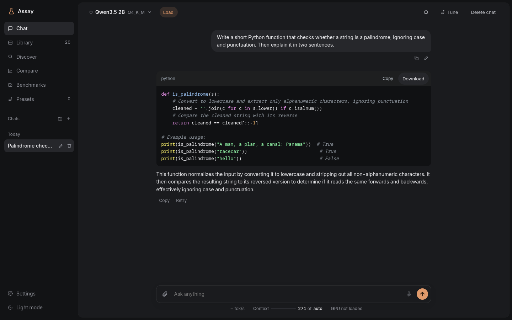
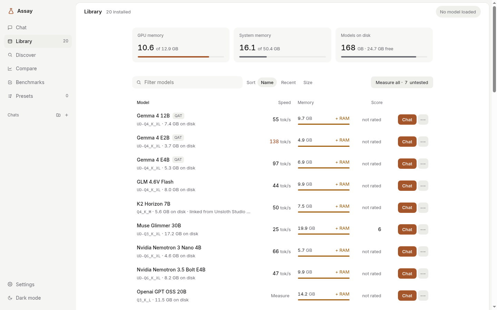
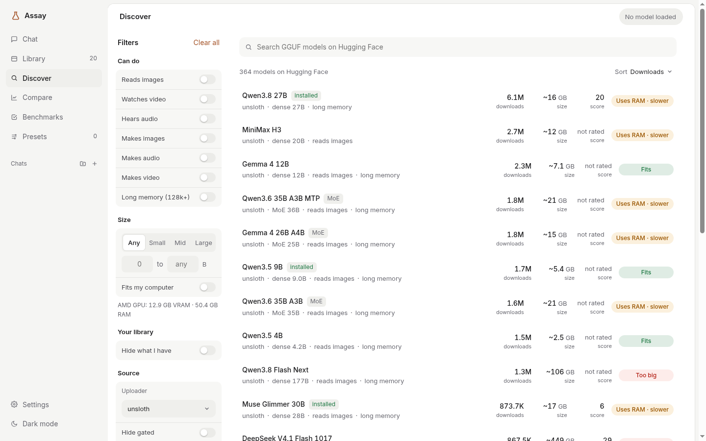
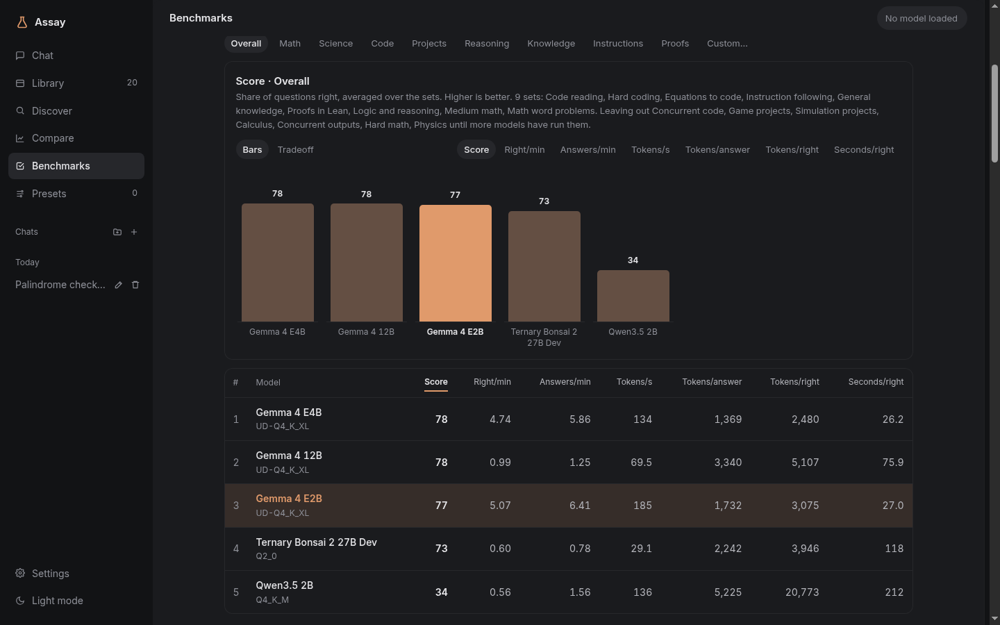
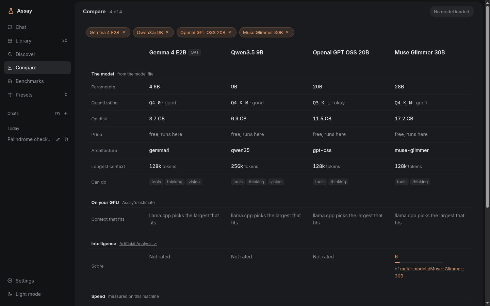

# Assay

Find, download, tune, benchmark and chat with AI models that run on your own
computer. Assay is one program with a web UI. It runs models with llama.cpp's
`llama-server` and keeps everything in plain files on your disk. There's no
database, no Docker and no account.

> **Beta.** Assay works day to day on Linux with an AMD GPU. Windows and macOS
> builds exist but have had little real-world use. Expect rough edges, and
> please [open an issue](../../issues) when something breaks.

## What it does

- **Discover models** on Hugging Face. Filter by what a model can do (images,
  audio, long context) and by size. Each quant says whether it fits on your
  GPU, needs some RAM as well, or is too big.
- **One-click downloads** that resume, plus import of models you already have
  in Ollama (by hard link, so nothing is copied).
- **Chat** with streaming replies, thinking blocks, attachments, code blocks
  you can copy or download, and live speed and context stats.
- **Tune** any chat with sliders (context length, temperature, system prompt and
  more), then save the settings as a **preset**.
- **Tools**: web search, fetching pages, a calculator, searching your
  chats and project files.
- **Projects**: folders of chats with shared instructions and files the model
  can search.
- **Benchmarks** on your own machine: 16 built-in sets (math, code that is run
  against hidden tests, Lean proofs, reasoning, knowledge and more). They're
  checked by machine, not by another model. A leaderboard ranks score
  against speed and tokens, and you can run each set at different
  reasoning levels.
- **Compare** up to four models side by side: size, quant quality, context,
  capabilities, intelligence score and measured speed.
- **API models** (any OpenAI-compatible endpoint, OpenRouter by default) sit
  next to local ones in chat, Compare and the benchmarks, with cost tracked.
- **An OpenAI-compatible API** at `/v1`, so editors like Zed can use your local
  models and presets.
- **Voice** (optional): dictate messages and have replies read aloud.

| | |
|---|---|
|  |  |
|  |  |

## Install

Download the archive for your system from the
[Releases](../../releases) page, unpack it, and optionally check it against
`SHA256SUMS`. There's a single binary inside: `assay` (or `assay.exe`).

Or build it yourself with Go (no C compiler needed):

    go build ./cmd/assay

## First run

    ./assay

Then open http://localhost:8484. A short setup page walks you through it:

1. It shows what your computer can run (GPU, VRAM and RAM).
2. It installs llama.cpp for your GPU: ROCm or Vulkan for AMD, CUDA for
   NVIDIA, or CPU only. You can use your own `llama-server` instead.
3. It suggests a first model that fits and downloads it.

Nothing is downloaded until you click, and each step says what it will fetch
and how big it is. Settings → Models updates llama.cpp later.

## Requirements

- Linux, Windows or macOS (64-bit).
- A GPU helps a lot but isn't required. Models that don't fit in VRAM spill
  into RAM and run slower, and Assay tells you before you download.
- Optional: Python 3 for the coding benchmarks, Lean for the proof
  benchmarks, and [uv](https://docs.astral.sh/uv/) for voice.

## Using it from other devices

By default Assay only listens on this computer. To reach it from your phone
or another machine:

    ./assay -listen 0.0.0.0:8484 -allow-host my-pc.tailnet.ts.net

Assay is single-user and has no login, so anyone who can reach that address
can use it. Keep it on a trusted network or behind something like Tailscale.

## Start on boot

    assay service install -listen 0.0.0.0:8484   # flags are optional
    assay service status
    assay service uninstall

This sets up a systemd user unit (Linux), a LaunchAgent (macOS) or a Run key
(Windows). On Linux, starting before you log in also needs
`loginctl enable-linger $USER`. Settings → This machine has the same switch.

## Where things are stored

| | Linux / macOS | Windows |
|---|---|---|
| Chats, benchmark results, llama.cpp | `~/.local/share/assay` | `%LOCALAPPDATA%\assay` |
| Settings and presets | `~/.config/assay` | `%APPDATA%\assay` |
| Models | chosen in Settings (default: inside the data folder) | same |

Everything is JSON or TOML, so it's easy to back up or read yourself.
`assay -help` lists every option.

## Known rough edges

- Loading models on Windows hasn't been tested on real hardware yet, and
  macOS has had very little testing.
- The phone layout is still basic.
- Some estimates (how much context fits, whether a quant fits) are cautious
  guesses and can be off for unusual models.

## How it works

[ARCHITECTURE.md](ARCHITECTURE.md) explains how the parts fit together: the
engine that starts and sizes `llama-server`, downloads, presets, benchmarks
and the rest.

## License

MIT. See [LICENSE](LICENSE).
